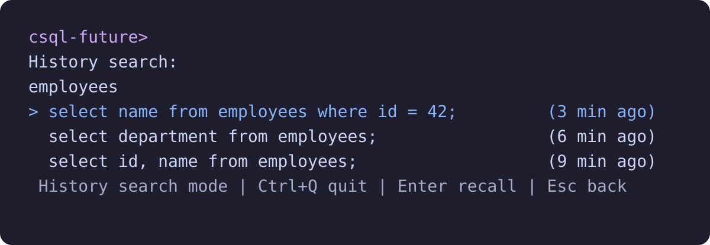

<p align="center">
  
</p>

**Find your last query. Finish your next one.**

`csql-future` adds persistent history, search, schema-aware completion, and
multiline editing to CUBRID's command-line SQL client. It runs your installed
`csql`, using the database and user you select.

[Get started](#get-started) · [Keyboard shortcuts](#keyboard-shortcuts) ·
[Usage guide](docs/usage.md) · [Report an issue](https://github.com/vimkim/csql-future/issues)

## Find the SQL you already wrote

Press **Ctrl+R**, type a few words, and recall a previous query for editing.
History survives restarts, keeps one entry per exact query, and shows when you
last submitted it. Multiline queries stay together.

<p align="center">
  
</p>

Recalling a query leaves it in the editor. You choose when to execute it.

## Let the schema finish the name

Press **Tab** to complete table, view, or column names from your database.
The editor reads the whole draft, including text after the cursor:

```sql
select <cursor> from employees;
```

With the cursor in the SELECT list, Tab offers columns from `employees`.
Simple aliases work too, as shown below with `e.`.

<p align="center">
  
</p>

Use Up/Down to choose a candidate and **Enter** to insert it. SQL runs only
after the list closes and you press Enter again. **Esc** keeps the original draft.
Completion also guides `SHOW TABLES` and `SHOW COLUMNS FROM/IN`.

*These are captures of the actual editor, using illustrative history and an
`employees` catalog from the test harness. [Regenerate the captures](assets/readme/README.md).*

## Get started

Requires Linux, Python **3.10+**, [uv](https://docs.astral.sh/uv/), and a CUBRID
environment with `csql` on `PATH`. The tool has no Python runtime dependencies.

```bash
uv tool install git+https://github.com/vimkim/csql-future.git
csql-future -u dba mydb
```

Use the same CSQL connection options you normally use, including `-S` for
standalone mode and `-C` for client/server mode. `--help` and `--version` also
work without a CUBRID installation.

To install from a checkout:

```bash
git clone https://github.com/vimkim/csql-future.git
cd csql-future
just sync
```

`just sync` installs the command into uv's tool bin directory, normally
`~/.local/bin`; keep it on `PATH`. The installed tool works independently of
the checkout. Existing `csql-with-history` users can install the new command
and keep using their existing `.csql_history.sqlite3` files.

## Keyboard shortcuts

| Key | Action |
| --- | --- |
| **Ctrl+R** | Search saved queries |
| **Tab** | Open completion; move to the next candidate when open |
| **Up / Down** | Move between draft lines; browse history at the boundaries |
| **Ctrl+P / Ctrl+N** | Browse history, or select a search/completion result |
| **Enter** | Accept a result; submit SQL when back in Input mode |
| **Ctrl+J** | Insert a newline; Ctrl+Enter also works with a compatible terminal |
| **Ctrl+X Ctrl+E** | Edit the draft in `$VISUAL`, `$EDITOR`, or `vi` |
| **F1** | Show help for the current mode |
| **Esc** | Close search/completion and keep the draft |
| **Ctrl+Q** | Quit from the editor, search, or help |

## Your client, with a more comfortable editor

- **Persistent history:** SQLite stores up to 10,000 unique submissions by
  default. History is local to the launch directory unless you select a shared file.
- **Database-aware names:** metadata comes from `db_class` and `db_attribute`
  through a separate, bounded `csql` process. Metadata queries stay outside your
  interactive SQL buffer and history.
- **Editable drafts:** multiline input, familiar Unix editing keys, and an
  external editor help you revise a query before submitting it.
- **Native batch behavior:** pipes, files, `-c` commands, and redirected launches
  pass straight through to `csql`, preserving its output and exit status.

| Option | Purpose |
| --- | --- |
| `--history-file PATH` | Select a SQLite file; default: `./.csql_history.sqlite3` |
| `--history-limit N` | Keep the latest N unique commands; default: 10,000 |
| `--no-history` | Read existing history without saving new submissions |
| `--no-completion` | Skip metadata queries and keep literal Tab input |

### Completion boundaries

In **client/server mode**, the first Tab loads metadata in the background.
Later requests refresh a cache older than 60 seconds; submit
`;refresh-completions` to refresh immediately. The separate connection sees
committed schema using the launch connection and user.

In **standalone mode**, metadata is read once before the interactive client
starts. Restart to see schema changes. Metadata reads use credentials supplied
at launch; a password entered later at CSQL's prompt cannot be reused.
If metadata is unavailable, editing and keyword completion remain available.

CTEs, derived-table columns, correlated outer aliases, synonyms, system tables,
and SQL held only in CSQL's internal command buffer are outside the current
completion scope. Interactive support is Linux-first; broader platform support
and ordinary-CSQL fallback for unsupported prompt states remain future work.

## Try it in your daily SQL work

Recall a query with Ctrl+R, change a table or column with Tab, and run it.
[Share a reproducible issue or suggestion](https://github.com/vimkim/csql-future/issues)
to help shape the next CSQL experience.

For the personal Nushell `cs` integration, detailed history behavior, terminal
handoffs, and verification coverage, see the [usage guide](docs/usage.md).
The [completion checklist](docs/completion-plan.md) records implementation evidence.

## Development

```bash
just test      # Unit and external-process PTY tests
just build     # Wheel and source distribution
```

Real-CUBRID acceptance scripts and their environment requirements are documented
in the [verification guide](docs/usage.md#verification).

## License

[Apache License 2.0](LICENSE). Original CUBRID copyright notices are preserved.
