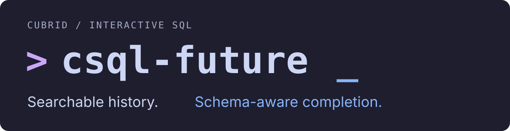
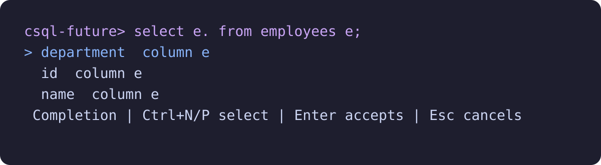

**한국어** | [English](README.en.md)

<p align="center">
  
</p>

**전에 쓴 SQL은 Ctrl+R로 찾고, 다음 SQL은 Tab으로 완성하세요.**

`csql-future`는 평소 쓰던 CUBRID `csql`에 **검색 가능한 명령 히스토리**,
**CUBRID 전용 자동 완성**, 여러 줄 편집을 더하는 터미널 도구입니다.
설치된 `csql`을 그대로 실행하며, 익숙한 접속 옵션과 SQL 실행 흐름을 이어 갑니다.

[설치](#get-started) · [단축키](#keyboard-shortcuts) ·
[사용 가이드](docs/usage.md) · [문서 목차](docs/README.md) ·
[CUBRID 구성원용 소개·시연](docs/internal-introduction.md)

<a id="watch-a-demodb-session"></a>

## 실제 demodb 세션을 확인하세요

<p align="center">
  
</p>

`s` 뒤에서 **Tab**으로 `SELECT`를 선택합니다. `/*+` 뒤에서 **Tab**으로 힌트 목록을
열고 `PARA`를 입력해 `PARALLEL`을 고릅니다. `FROM` 뒤의 **Tab**으로 `athlete`를
고른 다음 힌트 뒤 SELECT 목록으로 돌아가 **Tab**으로 해당 컬럼을 완성합니다.
영상은 쿼리 실행, `;plan detail` 완성, `;exit` 종료까지 보여 줍니다.
실제 편집기와 CUBRID 샘플 DB를 독립(`-S`) 모드로 실행한 녹화입니다.
[녹화 원본과 재생성 방법](assets/readme/README.md#live-demodb-recording)을 참고하세요.

## Ctrl+R: 쿼리를 다시 쓰는 대신 찾아서 고치세요

지난번에 쓴 테이블명이나 조건 몇 개만 기억나도 **Ctrl+R**로 찾을 수 있습니다.
예를 들어 `employees active`를 입력하면 두 단어가 모두 들어 있는 쿼리를 찾습니다.
단어 순서와 대소문자는 상관없고, 여러 줄 SQL도 하나의 검색 결과로 표시합니다.

퍼지 검색처럼 기억나는 단어로 범위를 좁히는 흐름입니다.
현재 매칭 규칙은 **공백으로 나눈 각 검색어가 쿼리 어딘가에 포함되는 방식**입니다.
오타 보정이나 검색어 내부의 글자를 건너뛰는 매칭은 지원하지 않습니다.

<p align="center">
  
</p>

영상은 `select name from athlete limit 3;`과 `select code from athlete limit 3;`을
실행한 뒤 **Ctrl+R**과 **아래 방향키**로 히스토리를 탐색합니다.
`name`을 검색하면 두 항목 중 일치하는 쿼리 하나만 남습니다.
**Enter**로 편집기에 불러온 다음, Enter를 다시 눌러 실행합니다.
[히스토리 GIF 재생성 방법](assets/readme/README.md#live-history-recording)을 참고하세요.

- **재시작 후에도 유지:** 기본으로 최근 고유 명령 10,000개를 SQLite에 보관합니다.
- **중복을 줄인 목록:** 완전히 같은 명령은 최신 제출 시각으로 갱신합니다.
- **여러 줄을 한 번에:** 긴 쿼리도 원문 그대로 불러와 수정합니다.
- **언제 썼는지 확인:** 각 항목에 마지막 제출 후 경과 시간을 표시합니다.

검색 결과에서 Enter를 누르면 SQL을 **편집기로 불러옵니다**.
수정한 뒤 다시 Enter를 눌러 실행할 수 있습니다.

## Tab: CUBRID 문법과 실제 스키마를 함께 완성하세요

일반 SQL 키워드뿐 아니라, CUBRID에서 자주 쓰는 조회·진단 문장과
CSQL 세션 명령, SQL 주석 힌트, 실제 테이블·컬럼 이름을 제안합니다.

| 입력 중인 내용 | Tab으로 확인할 수 있는 후보 |
| --- | --- |
| `SHOW TA` | `TABLES` 등 SHOW 문장 키워드 |
| `SHOW CREATE ` | `TABLE`, `VIEW` |
| `;pl` / `;plan ` | `;plan` / `simple`, `detail`, `off` |
| `;sc` / `;schema emp` | `;schema` / 접근 가능한 테이블·뷰 이름 |
| `SELECT /*+ RE` | `RECOMPILE`, `REEXECUTE` 등 CUBRID 힌트 이름 |
| `SELECT * FROM emp` | 접근 가능한 `employees` 등 테이블·뷰 이름 |
| `SELECT e.` 뒤에 `FROM employees e;`가 있는 초안 | 해당 테이블의 컬럼 이름 |

**SHOW 문장과 진단 SQL:** `SHOW TABLES`, `SHOW COLUMNS`, `SHOW INDEX`,
`SHOW CREATE TABLE`, `SHOW THREADS` 등을 문맥에 맞게 완성합니다.
`;plan`, `;trace`, `;schema`, `;get`, `;set` 같은 세션 명령과 주요 인자도 안내합니다.

**SQL 주석 힌트:** `/*+ ... */`, `--+`, `//+` 안에서 CUBRID 힌트 이름을
완성합니다. 현재 범위는 힌트 이름이며, 괄호 안의 테이블·인덱스 인자는 직접 입력합니다.

**스키마 기반 완성:** 접속한 사용자에게 보이는 테이블·뷰와 해당 컬럼을 제안합니다.
`e.` 같은 단순 별칭을 이해하고, 커서 뒤에 있는 `FROM` 절도 읽습니다.

```sql
select <cursor> from employees;
```

위 초안에서 SELECT 목록에 커서를 두고 Tab을 누르면 `employees`의 컬럼을 제안합니다.
`<cursor>`는 설명을 위한 커서 위치 표시입니다.

<p align="center">
  
</p>

목록을 연 채 계속 입력하면 후보를 좁히고, Backspace로 다시 넓힐 수 있습니다.
위·아래 키로 후보를 고르고 **Enter**로 삽입합니다.
목록이 닫힌 뒤 Enter를 다시 눌러야 SQL이 제출됩니다. **Esc**는 현재 초안을 유지합니다.

*정적 자동 완성 화면은 실제 편집기를 테스트용 `employees` 스키마로 실행해 캡처했습니다.
[캡처 재생성 방법](assets/readme/README.md)을 참고하세요.*

<a id="get-started"></a>

## 설치하고 평소 csql처럼 접속하세요

Linux, Python **3.10 이상**, [uv](https://docs.astral.sh/uv/),
`PATH`에 `csql`이 있는 CUBRID 환경이 필요합니다. 필수 Python 런타임 의존성은 없습니다.

```bash
uv tool install git+https://github.com/vimkim/csql-future.git
csql-future -u dba mydb
```

기존 CSQL 접속 옵션을 그대로 사용합니다. 독립 모드는 `-S`, 클라이언트/서버 모드는 `-C`입니다.
`--help`와 `--version`은 CUBRID 설치 없이도 확인할 수 있습니다.

소스 체크아웃에서 설치하려면 다음 명령을 실행하세요.

```bash
git clone https://github.com/vimkim/csql-future.git
cd csql-future
just sync
```

`just sync`는 uv 도구 디렉터리(일반적으로 `~/.local/bin`)에 명령을 설치합니다.
이 경로를 `PATH`에 추가하세요. 설치 후에는 소스 체크아웃과 독립적으로 실행됩니다.
기존 `csql-with-history`의 `.csql_history.sqlite3` 파일도 이어서 사용할 수 있습니다.

<a id="keyboard-shortcuts"></a>

## 먼저 익힐 단축키

| 키 | 동작 |
| --- | --- |
| **Ctrl+R** | 저장된 명령을 여러 검색어로 검색 |
| **Tab** | 자동 완성 열기, 열린 목록에서 다음 후보 선택 |
| **위 / 아래** | 초안의 줄 이동, 첫 줄·마지막 줄에서 히스토리 탐색 |
| **Ctrl+P / Ctrl+N** | 히스토리 탐색 또는 검색·완성 후보 선택 |
| **Enter** | 후보 선택, 입력 모드에서는 초안 제출 |
| **Ctrl+J** | 줄바꿈 삽입. 호환 터미널에서는 Ctrl+Enter도 가능 |
| **Ctrl+X Ctrl+E** | `$VISUAL`, `$EDITOR`, `vi` 순으로 외부 편집기 열기 |
| **F1** | 현재 모드의 도움말 |
| **Esc** | 검색·완성을 닫고 초안 유지 |
| **Ctrl+Q** | 편집기·검색·도움말에서 종료 |

## 매일 쓰는 csql 흐름에 맞췄습니다

- **기존 클라이언트 사용:** 선택한 데이터베이스와 사용자로 설치된 `csql`을 실행합니다.
- **다시 고치기 편한 입력:** 여러 줄 초안, Unix 편집 키, 외부 편집기를 지원합니다.
- **작업별 히스토리:** 기본 파일은 실행 디렉터리의 `./.csql_history.sqlite3`입니다.
  같은 호스트에서 파일 경로를 지정해 여러 작업 디렉터리의 히스토리를 공유할 수 있습니다.
- **배치 실행 유지:** 파이프, 파일 입력, `-c`, 입출력 리다이렉션은 `csql`로 직접 전달합니다.
  출력과 종료 상태도 유지합니다.

| 옵션 | 용도 |
| --- | --- |
| `--history-file PATH` | 히스토리 SQLite 파일 선택 |
| `--history-limit N` | 최근 고유 명령 보관 수 지정. 기본 10,000개 |
| `--no-history` | 기존 히스토리는 읽되 새 명령은 저장하지 않음 |
| `--no-completion` | 메타데이터 조회를 생략하고 Tab을 문자 그대로 입력 |

### 스키마 완성의 동작 범위

클라이언트/서버 모드에서는 첫 Tab에 메타데이터를 백그라운드로 읽습니다.
이후 요청 시 60초가 지난 캐시를 갱신하며, `;refresh-completions`로 즉시 갱신할 수 있습니다.
별도 연결이 시작 시 지정한 사용자와 접속 대상으로 **커밋된 스키마**를 읽습니다.

독립 모드에서는 대화형 클라이언트가 시작되기 전에 메타데이터를 한 번 읽습니다.
스키마 변경을 반영하려면 다시 시작하세요. 조회에는 시작 인자로 전달한 자격 증명을 사용하며,
나중에 CSQL 프롬프트에 입력한 비밀번호는 재사용할 수 없습니다.
메타데이터를 읽지 못해도 편집과 키워드 완성은 사용할 수 있습니다.

현재 스키마 완성 범위에는 CTE, 파생 테이블 컬럼, 상관 서브쿼리의 외부 별칭,
동의어, CSQL 내부 명령 버퍼에만 남아 있는 SQL은 포함되지 않습니다.
대화형 지원은 Linux를 우선합니다. 자세한 동작과 제약은 [사용 가이드](docs/usage.md)에 있습니다.

## 앞으로: 터미널에서 익힌 완성을 편집기까지

별도 프로젝트 [cubrid-language-tools](https://github.com/vimkim/cubrid-language-tools)에서
공통 언어 엔진을 개발하고, csql-future와 편집기가 이를 사용하도록 확장할 계획입니다. 다음 항목은 **예정 기능**입니다.

| 단계 | 목표 |
| --- | --- |
| 공통 완성 엔진 + **LSP** | 터미널과 편집기에서 완성 로직을 공유하는 언어 서버 |
| **오프라인 문법 검사 / 린팅** | SQL을 실행하지 않고 CUBRID 파서로 문법 오류 위치 안내 |
| **VS Code 확장** | 자동 완성, 문법 진단, 구문 강조, 기본 들여쓰기 |
| **Neovim 지원** | 같은 LSP를 이용한 자동 완성·진단과 구문 강조 |
| 후속 확장: **포매팅** 등 | CUBRID SQL 포매터와 편집기 포매팅 연동, Tree-sitter 검토 |

첫 언어 도구 배포 계획은 CUBRID 11.5의 특정 빌드 검증부터 시작합니다.
포매팅과 의미·스타일 린팅은 이후 확장 목표입니다.
지금도 Ctrl+X Ctrl+E로 Neovim 등 외부 편집기를 열 수 있으며, LSP 연동은 별도 예정 기능입니다.
[로드맵](docs/roadmap.md)과 [공통 엔진 프로젝트](https://github.com/vimkim/cubrid-language-tools)에서 범위를 확인하세요.

## 오늘 쓰는 쿼리 하나로 시작해 보세요

`csql-future`로 접속해 쿼리 하나를 실행한 다음, Ctrl+R로 찾아 수정해 보세요.
이어서 `SHOW `, `;`, 테이블명, 컬럼 위치에서 Tab을 눌러 보세요.
자주 쓰는 SQL을 찾고 고치는 흐름에서 먼저 활용할 수 있습니다.

[내부 공유용 소개·시연](docs/internal-introduction.md)을 팀에 전달하거나,
[재현 가능한 문제와 제안](https://github.com/vimkim/csql-future/issues)을 남겨 주세요.

## 개발과 검증

```bash
just test      # 단위 테스트와 외부 프로세스·PTY 테스트
just build     # wheel과 소스 배포 파일 생성
```

실제 CUBRID 검증 스크립트와 환경 조건은 [검증 안내](docs/usage.md#verification)에 있습니다.
구현 이력은 [자동 완성 체크리스트](docs/completion-plan.md)에서 확인할 수 있습니다.

## 라이선스

[Apache License 2.0](LICENSE). 기존 CUBRID 저작권 고지를 보존합니다.
