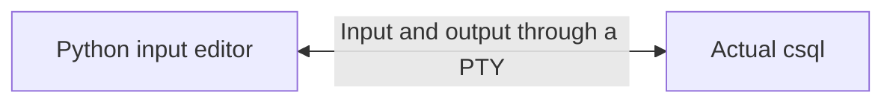
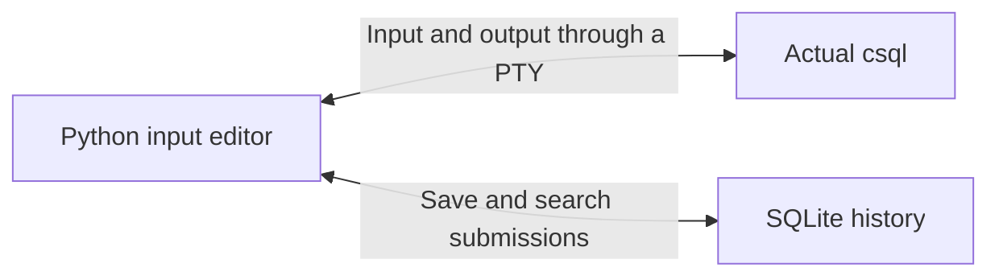
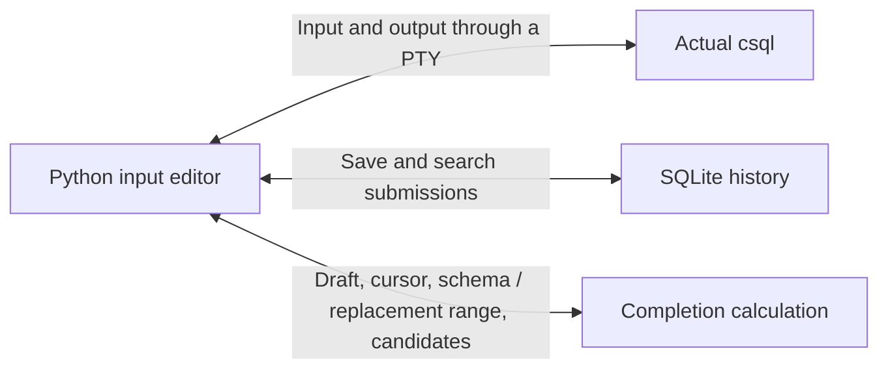

# csql-future architecture and reconstruction order

[한국어](architecture.md) | **English**

`csql-future` places a **Python terminal editor in front of the existing `csql` program**.
`csql` handles connections, SQL execution, and transactions. Python handles input editing, history, and completion.

This explanation describes the implementation at `dc6ae3e`.
It explains execution and data contracts in the order that you can implement them without reading the source.

First, connect Python to the actual `csql` process.



A pseudoterminal, or PTY, appears as a terminal to the child process.
Python creates a child with `pty.fork()`. The child executes `csql`.
The Python parent reads and writes bytes through the other end of the PTY.
`csql` continues to operate as an interactive program.
[Process connection](../src/csql_future/cli.py#L1192)

Keep the `csql` process alive throughout the session.
A new process for each query would lose transaction state, session settings, and the internal CSQL SQL buffer.

For pipes, redirection, `-c`, and `-i`, the wrapper does not use the Python editor.
It replaces itself with `csql` through `os.execv()`. This preserves standard streams and the exit status.

The central implementation question is **which program should receive keyboard input now**.

- Python receives input while the user edits SQL.
- Authentication, SQL execution, a pager, or a shell receives input through the PTY.
- Python resumes its editor when `csql` waits for the next SQL input.

A temporary absence of output does not prove that SQL execution ended.
Using that condition would display the editor during a slow query.
A prompt string alone is also insufficient. Query results can contain the same string.

The current implementation checks these conditions together.

1. Set `CUBRID_CSQL_PROMPT` to a private prompt containing a new UUID for each launch.
2. Find that prompt in the output.
3. Check that the child PTY uses noncanonical input with echo disabled.
4. Check Linux `/proc` for temporary child programs that use the same terminal.

Accumulate received output in a temporary buffer. The prompt can span several reads.
Retain a suffix that could be part of the prompt until the next read.
[Input boundary handling](../src/csql_future/cli.py#L1243)

This boundary prevents the editor from treating a password or shell command as an SQL draft and saving it.

Build the Python editor around a string and a cursor.

```text
TextBuffer
    text       Current draft string
    cursor     Cursor position within the string
    killed     Most recently cut string
```

Process keyboard input in this order.

```text
Keyboard bytes
→ Decode UTF-8 characters and escape sequences
→ Produce events such as INSERT, LEFT, and SUBMIT
→ Handle each event according to the current mode
→ Display the updated state
```

Separate byte decoding from string editing.
The SQL draft and the history search query can then use the same editing operations.

Enter has a different meaning in each mode.

| Current state | Enter action |
| --- | --- |
| Normal input | Submit the draft |
| History search | Copy the selected command into the draft |
| Completion | Insert the selected candidate into the draft |
| Help | Close help |

Search and completion change only the draft. SQL submission occurs only in normal input mode.
[Mode-specific event handling](../src/csql_future/cli.py#L542)

Separate screen coordinates from string positions too.
Korean characters, tabs, and combining characters can have display widths that differ from their string lengths.
Arrange the string within the terminal width, then calculate the cursor row and column.

The implementation remembers the previously displayed rows and writes changed rows together.
This reduces flicker from erasing and redrawing the editor on every key event.
Query results remain in terminal scrollback.
[Screen updates](../src/csql_future/cli.py#L991)

When the editor returns a draft, the outer execution loop performs these operations.

```text
Receive the draft
→ Save the entire draft in history
→ Split the draft into physical lines
→ Send each line to csql and wait for the next input boundary
→ Return to the Python editor
```

Python does not inspect semicolons to decide whether to execute SQL.
Actual CSQL handles SQL parsing, automatic execution, `;xrun`, and its internal command buffer.

The **Python draft and the internal CSQL buffer are different data**.
Two separately submitted drafts can accumulate into one SQL statement inside CSQL.
History still records two submissions.
[Submission semantics](usage.en.md#persistent-history)

Add history at this submission boundary.



The essential history fields are `id`, `command`, and `submitted_at`.

Use one short SQLite transaction to remove the previous identical command, insert the new entry, and remove entries beyond the retention limit.
Store a multiline draft as one string. The default limit is 10,000 unique commands.

Save before sending the draft to CSQL. Failed SQL can then return to the editor for correction.
If persistent storage fails, use memory history and continue editing and forwarding SQL.

Ctrl+R search uses this condition.

```python
terms = query.casefold().split()
matches = [
    entry for entry in history
    if all(term in entry.command.casefold() for term in terms)
]
```

Case and search-term order do not matter. Each result must contain every term as a substring.
Copy the selected result into the draft.
[History implementation](../src/csql_future/cli.py#L153)

Add completion as a separate calculation.



Use this completion function contract.

```text
suggest(text, cursor, schema)
    → Suggestions(start, end, candidates)
```

This function does not draw the screen or connect to the database.
It calculates a result from its arguments. You can implement it with a synthetic schema first.

In this example, `|` marks the cursor.

```sql
SELECT e.na|wrong FROM employees e;
```

Process this input as follows.

1. Distinguish words, strings, comments, quoted identifiers, and parentheses.
2. Retain each token's original start and end positions.
3. Identify the statement and subquery scope containing the cursor.
4. **Read beyond the cursor** to find `FROM employees e`.
5. Resolve `e` to `employees`.
6. Produce the column candidate `name`, which starts with `na`.
7. Return the whole current token, `nawrong`, as the replacement range.

Apply the selected candidate with this calculation.

```python
new_text = text[:start] + candidate.text + text[end:]
new_cursor = start + len(candidate.text)
```

The result is:

```sql
SELECT e.name FROM employees e;
```

Candidate filtering uses only the prefix before the cursor. Replacement also removes the rest of the current token after the cursor.
The following `FROM` clause remains intact.
[Completion and replacement contract](../src/csql_future/completion.py#L383)

The tokenizer must accept unclosed quotes and comments. Completion receives SQL while the user is still writing it.

Represent partial command grammar with rules such as these.

```text
SHOW COLUMNS FROM <relation>
SHOW CREATE TABLE <table>
SHOW GRANTS FOR <user>
```

Compare existing tokens with the rules to identify the next keyword or required object type.
This analysis supplies completion candidates. CSQL performs the final syntax check for SQL execution.
[Context rules](../src/csql_future/syntax.py#L79)

Next, replace the synthetic schema with actual metadata.

`Schema` contains users, owners, tables, views, columns, and indexes.
A separate `csql` process reads catalog metadata and publishes an immutable snapshot.
The catalog query does not enter the user's SQL buffer or history.

The connection mode determines when that process runs.

| Mode | Schema loading |
| --- | --- |
| CS | Start a background read on the first Tab. Refresh on a later request if 60 seconds elapsed. |
| SA | Read once before starting interactive CSQL. Use that initial snapshot throughout the session. |

SA loading finishes first to avoid opening a second standalone client while interactive CSQL owns the database.

The background task updates only `Schema`, the status message, and the revision.
**Only the editor thread draws the screen.** When the revision changes, the editor recalculates an open completion menu.
The current request limits are 3 seconds and 16 MiB. A failed request leaves cached names or static keywords available.
[Schema cache](../src/csql_future/metadata.py#L95)

The separate connection cannot see the current session's uncommitted schema changes.
Restart the wrapper if the connection user or target changes after launch.

Use this order to reconstruct the program.

1. **Implement launch routing.** Detect interactive execution. Use `exec` for batch execution.
   Check output and exit status against direct CSQL execution.
2. **Implement PTY forwarding.** Keep one CSQL process alive through authentication, queries, and exit.
   Add editing later.
3. **Implement the input boundary.** Check the private prompt, terminal state, and child programs.
   The editor must stay inactive during a slow query.
4. **Add the text editor.** Separate the string, cursor, key events, and screen layout.
   Forward the submitted draft one physical line at a time.
5. **Add history and search.** Save submitted drafts. Copy search results into the draft.
   Check that failed SQL can return to the editor.
6. **Implement completion with a synthetic schema.** Check candidates and replacement ranges before adding the completion menu.
7. **Connect catalog loading.** Separate CS background reads from SA reads before launch.
   Check that editing continues when metadata loading fails.
8. **Check terminal boundaries.** Cover split prompts, passwords, pagers, shells, Ctrl+C, window resizing, and terminal restoration after exit.

The file layout does not map each responsibility to a separate file.
[cli.py](../src/csql_future/cli.py) contains launch routing, PTY forwarding, editing, and history.
Completion calculation, context rules, and metadata loading use separate files.

The completion examples and 44 related unit tests passed against the implementation described here.
The shared language engine, LSP, linting, and editor extensions belong to the separate `cubrid-language-tools` plan.
The architecture above describes the current terminal program. See the [roadmap](roadmap.en.md) for scope.
