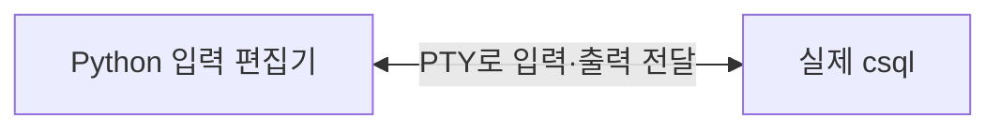
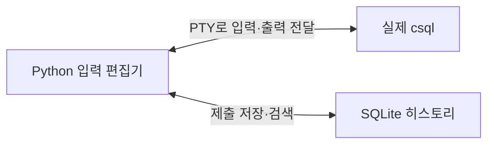
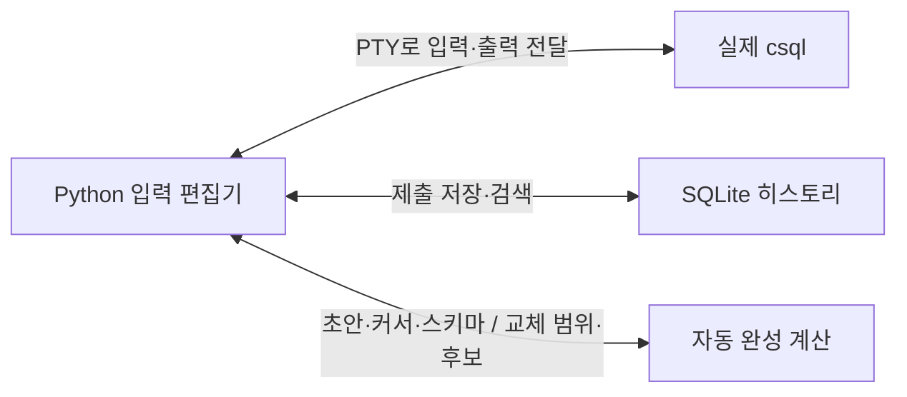

# csql-future 아키텍처와 재구현 순서

**한국어** | [English](architecture.en.md)

`csql-future`는 **기존 `csql` 앞에 Python 터미널 편집기를 붙인 프로그램**입니다.
접속·SQL 실행·트랜잭션은 `csql`이 맡고, Python은 입력 편집·히스토리·자동 완성을 맡습니다.

이 설명은 `dc6ae3e`의 구현을 기준으로 합니다. 코드를 보지 않고도 다시 만들 수 있도록
기능이 붙는 순서대로 실행 구조와 데이터 계약을 설명합니다.

먼저 필요한 것은 Python과 실제 `csql`을 연결하는 부분입니다.



PTY는 자식 프로세스에 터미널처럼 보이는 장치입니다. Python에서 `pty.fork()`로 자식을 만들고,
자식에서 `csql`을 실행합니다. 부모 Python은 PTY 반대편으로 바이트를 읽고 씁니다.
`csql`은 평소처럼 대화형 프로그램으로 동작합니다.
[실제 연결 코드](../src/csql_future/cli.py#L1192)

여기서 `csql` 프로세스는 세션 내내 유지합니다. 쿼리를 보낼 때마다 새로 실행하면
트랜잭션·세션 설정·CSQL 내부 SQL 버퍼가 이어지지 않습니다.

반면 파이프·리다이렉션·`-c`·`-i` 같은 비대화형 실행에서는 Python 편집기를 사용하지 않습니다.
`os.execv()`로 프로세스 자체를 `csql`로 교체합니다. 이렇게 표준 입출력과 종료 상태를 유지합니다.

가장 중요한 구현 문제는 **지금 키보드 입력을 누가 받아야 하는가**입니다.

- SQL을 편집하는 동안에는 Python이 입력을 받습니다.
- 접속 인증·SQL 실행·pager·셸 사용 중에는 입력을 실제 프로그램으로 전달합니다.
- `csql`이 다음 SQL 입력을 기다리면 Python 편집기로 돌아옵니다.

단순히 "출력이 잠깐 없으면 입력 준비 완료"라고 판단하면 오래 걸리는 쿼리 도중에 편집기가 나타납니다.
프롬프트 문자열만 검사해도 쿼리 결과에 같은 문자열이 있을 때 문제가 생깁니다.

그래서 현재 구현은 다음 정보를 함께 확인합니다.

1. 실행마다 UUID를 넣은 전용 프롬프트를 `CUBRID_CSQL_PROMPT`로 지정합니다.
2. 출력에서 그 프롬프트를 찾습니다.
3. 자식 PTY가 실제 입력 상태인 비정규 모드·에코 비활성 상태인지 확인합니다.
4. Linux `/proc`로 같은 터미널을 사용하는 임시 자식 프로그램이 있는지도 확인합니다.

읽은 출력은 임시 버퍼에 쌓습니다. 프롬프트가 여러 번의 읽기로 쪼개질 수 있으므로,
프롬프트의 일부일 수 있는 끝부분은 다음 읽기까지 보관합니다.
[입력 경계 처리](../src/csql_future/cli.py#L1243)

이 경계가 정확해야 비밀번호나 셸 명령이 SQL 초안으로 잘못 저장되지 않습니다.

Python 편집기는 문자열과 커서를 중심으로 만듭니다.

```text
TextBuffer
    text       편집 중인 문자열
    cursor     문자열 안의 커서 위치
    killed     마지막으로 잘라낸 문자열
```

키 입력 처리는 다음 순서입니다.

```text
키보드 바이트
→ UTF-8 문자·이스케이프 시퀀스 해석
→ INSERT, LEFT, SUBMIT 같은 이벤트
→ 현재 모드에 따라 처리
→ 변경된 상태를 화면에 표시
```

키 바이트를 해석하는 코드와 문자열을 수정하는 코드를 분리합니다.
그러면 SQL 초안과 히스토리 검색어가 같은 편집 동작을 사용할 수 있습니다.

같은 Enter도 모드마다 의미가 다릅니다.

| 현재 상태 | Enter의 동작 |
| --- | --- |
| 일반 입력 | 초안을 제출 |
| 히스토리 검색 | 선택한 명령을 초안으로 불러오기 |
| 자동 완성 | 선택한 후보를 초안에 삽입 |
| 도움말 | 도움말 닫기 |

검색과 완성은 편집 중인 문자열까지만 바꿉니다. SQL 제출은 일반 입력 모드에서만 일어납니다.
[모드별 이벤트 처리](../src/csql_future/cli.py#L542)

화면 좌표도 문자열 위치와 분리해야 합니다. 한글·탭·결합 문자는 문자열 길이와 표시 너비가 다릅니다.
문자열을 터미널 너비에 맞게 배치한 뒤 커서의 화면 행·열을 계산합니다.

현재 구현은 이전에 그린 행을 기억하고 바뀐 행만 한 번에 씁니다.
키를 누를 때마다 화면을 지웠다가 다시 그리던 깜박임을 줄이기 위한 변경입니다.
쿼리 결과는 터미널 스크롤백에 남깁니다.
[화면 갱신](../src/csql_future/cli.py#L991)

편집기가 초안을 반환하면 상위 실행 루프가 다음 일을 합니다.

```text
초안 받기
→ 히스토리에 초안 전체 저장
→ 초안을 물리적인 줄로 나누기
→ 각 줄을 csql에 전달하고 다음 입력 경계 기다리기
→ Python 편집기로 복귀
```

Python은 세미콜론을 분석해서 SQL 실행 여부를 결정하지 않습니다.
SQL 파싱·자동 실행·`;xrun`·내부 명령 버퍼는 실제 CSQL의 책임입니다.

따라서 **Python 초안과 CSQL 내부 버퍼는 서로 다른 데이터**입니다.
Python에서 두 번 제출한 문자열이 CSQL 내부에서는 하나의 SQL로 누적될 수도 있습니다.
히스토리에는 두 번의 제출로 남습니다.
[제출 단위의 의미](usage.md#영구-히스토리)

이 제출 지점에 히스토리를 붙이면 구조가 다음처럼 늘어납니다.



히스토리의 핵심 데이터는 `id`, `command`, `submitted_at`입니다.

저장할 때에는 짧은 SQLite 트랜잭션 하나에서 같은 본문의 이전 항목을 지우고,
새 항목을 넣고, 보관 한도를 넘은 오래된 항목을 지웁니다.
여러 줄 초안도 문자열 하나로 저장합니다. 기본 보관 한도는 고유 명령 10,000개입니다.

저장은 CSQL에 전달하기 전에 합니다. 따라서 실패한 SQL도 다시 불러와 고칠 수 있습니다.
저장소에 문제가 생기면 메모리 히스토리로 전환하고 편집과 SQL 전달은 계속합니다.

Ctrl+R 검색은 다음 조건으로 구현됩니다.

```python
terms = query.casefold().split()
matches = [
    entry for entry in history
    if all(term in entry.command.casefold() for term in terms)
]
```

대소문자와 검색어 순서는 무관합니다. 모든 검색어를 포함하는 부분 문자열 검색입니다.
선택한 결과는 초안으로 복사합니다.
[히스토리 구현](../src/csql_future/cli.py#L153)

자동 완성은 별도의 계산으로 붙입니다.



완성 함수의 계약은 다음이면 됩니다.

```text
suggest(text, cursor, schema)
    → Suggestions(start, end, candidates)
```

화면을 그리거나 DB에 접속하는 동작은 이 함수에 넣지 않습니다.
입력으로 받은 정보만 계산합니다. 그래서 가짜 스키마로 먼저 구현할 수 있습니다.

예를 들어 `|`가 커서라고 합시다.

```sql
SELECT e.na|wrong FROM employees e;
```

이 입력을 처리하려면 다음 과정이 필요합니다.

1. 단어·문자열·주석·인용 식별자·괄호를 구분합니다.
2. 각 토큰의 원문 시작·끝 위치를 보관합니다.
3. 커서가 있는 문장과 서브쿼리 범위를 찾습니다.
4. **커서 뒤까지 읽어서** `FROM employees e`를 찾습니다.
5. `e`를 `employees`에 연결합니다.
6. `na`로 시작하는 컬럼 후보 `name`을 만듭니다.
7. 교체 범위는 현재 토큰 전체인 `nawrong`으로 반환합니다.

선택 결과를 적용하는 계산은 단순합니다.

```python
new_text = text[:start] + candidate.text + text[end:]
new_cursor = start + len(candidate.text)
```

결과는 다음과 같습니다.

```sql
SELECT e.name FROM employees e;
```

커서 왼쪽만 후보 검색에 사용하지만, 교체할 때는 토큰의 오른쪽 부분까지 제거합니다.
뒤의 `FROM` 절은 보존합니다.
[완성 계산과 교체 계약](../src/csql_future/completion.py#L383)

토크나이저는 닫히지 않은 따옴표나 주석도 받아야 합니다.
자동 완성의 입력은 작성 중인 SQL이기 때문입니다.

SHOW·세션 명령은 다음처럼 부분 문법을 규칙으로 관리합니다.

```text
SHOW COLUMNS FROM <relation>
SHOW CREATE TABLE <table>
SHOW GRANTS FOR <user>
```

현재까지 입력한 토큰을 규칙과 비교해 다음 키워드나 필요한 객체 종류를 알아냅니다.
이것은 완성 후보를 위한 문맥 분석입니다. 실행할 SQL의 최종 문법 검사는 CSQL이 합니다.
[문맥 규칙](../src/csql_future/syntax.py#L79)

이제 가짜 스키마를 실제 데이터로 바꾸면 됩니다.

`Schema`에는 사용자, 소유자, 테이블·뷰, 컬럼, 인덱스 등을 담습니다.
별도의 `csql` 프로세스가 카탈로그를 조회하고, 결과를 해석해 불변 스냅샷으로 게시합니다.
조회 SQL은 사용자 SQL 버퍼와 히스토리에 들어가지 않습니다.

여기서는 접속 모드에 따라 순서가 달라집니다.

| 모드 | 스키마 조회 방식 |
| --- | --- |
| CS | 첫 Tab에서 백그라운드 조회. 이후 요청할 때 60초가 지났으면 갱신 |
| SA | 대화형 CSQL이 시작되기 전에 한 번 조회. 실행 중에는 시작 스냅샷 사용 |

SA에서 이렇게 하는 이유는 대화형 CSQL이 DB를 소유하는 동안 두 번째 독립 클라이언트를 열지 않기 위해서입니다.

백그라운드 작업은 `Schema`, 상태 메시지, revision만 갱신합니다.
**화면은 편집기 스레드만 그립니다.** 편집기는 revision이 바뀌면 열린 완성 목록을 다시 계산합니다.
현재 조회 제한은 3초·16MiB이며, 실패하면 기존 캐시나 정적 키워드를 사용합니다.
[스키마 캐시](../src/csql_future/metadata.py#L95)

별도 연결이므로 현재 세션의 미커밋 스키마 변경은 보이지 않습니다.
시작 후 접속 사용자나 대상을 바꾼 경우에도 래퍼를 재시작해야 합니다.

직접 구현할 때에는 다음 순서가 적절합니다.

1. **실행 분기부터 만듭니다.** 대화형 여부를 판단하고 배치는 `exec`로 전달합니다.
   출력과 종료 상태가 직접 CSQL 실행과 같은지 확인합니다.
2. **PTY 중계만 만듭니다.** 한 개의 CSQL을 유지하며 인증·쿼리·종료를 처리합니다.
   아직 편집 기능은 붙이지 않습니다.
3. **입력 경계를 구현합니다.** 전용 프롬프트·터미널 상태·자식 프로그램을 확인합니다.
   느린 쿼리 중 편집기가 나타나지 않아야 합니다.
4. **텍스트 편집기를 붙입니다.** 문자열·커서·키 이벤트·화면 배치를 분리합니다.
   Enter로 반환한 초안을 줄별로 전달합니다.
5. **히스토리와 검색을 붙입니다.** 제출한 초안만 저장하고, 검색 결과는 초안으로 불러옵니다.
   실패한 SQL도 복원되는지 확인합니다.
6. **가짜 스키마로 완성 함수를 만듭니다.** 후보 내용과 교체 범위를 먼저 검증한 뒤 완성 메뉴를 붙입니다.
7. **실제 카탈로그를 연결합니다.** CS 백그라운드 조회와 SA 사전 조회를 구분하고,
   조회 실패 중에도 편집이 되는지 확인합니다.
8. **터미널 경계를 검증합니다.** 분할된 프롬프트, 비밀번호, pager·셸, Ctrl+C,
   창 크기 변경, 종료 후 터미널 설정 복원을 확인합니다.

현재 파일 배치는 이 책임 구분과 완전히 같지는 않습니다.
실행·PTY·편집기·히스토리는 [cli.py](../src/csql_future/cli.py)에 함께 있고,
완성 계산·문맥 규칙·메타데이터 조회가 별도 파일로 나뉘어 있습니다.

이 설명의 완성 예제와 관련 단위 테스트 44개를 확인했습니다.
공통 언어 엔진·LSP·린트·편집기 확장은 별도 `cubrid-language-tools`의 계획이며,
위 구조는 현재 터미널 프로그램의 동작입니다. 자세한 범위는 [로드맵](roadmap.md)을 참고하세요.
